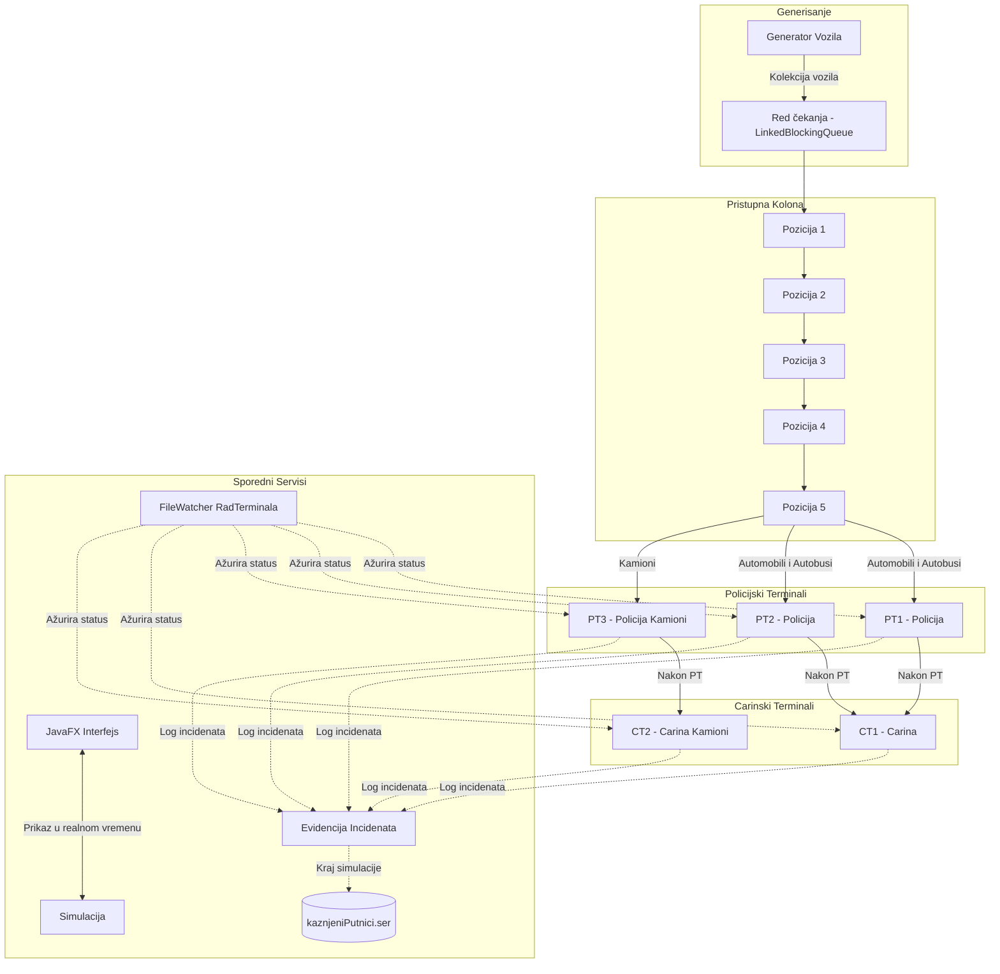

# 🚗 Simulacija Graničnog Prelaza (Border Crossing Simulator)

Višenitna simulacija graničnog prelaza realizovana u programskom jeziku **Java** uz grafički korisnički interfejs u **JavaFX-u**. Projekat je razvijen u okviru predmeta **Programski jezici 2 (PJ2)** na Elektrotehničkom fakultetu Univerziteta u Banjoj Luci.

---

## 📌 Pregled Projekta

Sistem simulira kretanje i kontrolu različitih kategorija vozila (automobili, kamioni, autobusi) prilikom prelaska državne granice. Granični prelaz raspolaže sa:
- **3 Policijska terminala** (PT1 i PT2 za lična vozila i autobuse, PT3 za kamione)
- **2 Carinska terminala** (CT1 za lična vozila i autobuse, CT2 za kamione)

Svako vozilo, svaki terminal, kao i servis za dinamičko praćenje stanja terminala (`FileWatcher`) izvršavaju se u **zasebnim nitima (multithreading)**, uz precizne mehanizme sinhronizacije (`wait/notify`, zaključavanja, niti-demoni i atomske promenljive).

---

## 🏗️ Arhitektura Sistema



---

## ⚙️ Ključne Funkcionalnosti

### 1. Model Vozila i Putnika
- **Lična vozila (`LicnoVozilo`)**:
  - Kapacitet: do 5 putnika.
  - Na carinskom terminalu nema detaljnih provjera, već se zadržava fiksno konfigurisano vrijeme.
- **Autobusi (`Autobus`)**:
  - Kapacitet: do 52 putnika.
  - Detaljan carinski pregled kofera svakog putnika.
- **Kamioni (`Kamion`)**:
  - Kapacitet: do 3 putnika (vozač i saputnici).
  - Ima definisanu **deklarisanu** i **stvarnu masu** tereta, kao i status o potrebi za carinskom dokumentacijom.
- **Putnici (`Putnik`)**:
  - Svaki putnik posjeduje identifikacioni dokument (`Dokument`).
  - Može posjedovati kofer (`Kofer`) sa prtljagom.

### 2. Vjerovatnoće i Incidentne Situacije
Parametri generisanja su u potpunosti podesivi kroz konfiguracioni fajl:
- **Neispravni dokumenti (3%)**:
  - Ako vozač nema ispravan dokument, **cijelo vozilo se vraća/zaustavlja** i zabranjuje mu se prelazak granice.
  - Ako putnik nema ispravan dokument, **putnik se isključuje iz vozila**, dodaje na listu kažnjenih lica, a vozilo nastavlja dalje.
- **Nedozvoljene stvari u prtljagu (10%)**:
  - Prilikom pregleda autobusa na carini, putnik sa nedozvoljenim stvarima u koferu biva udaljen iz autobusa i evidentiran.
- **Prekoračenje mase tereta kod kamiona (20%)**:
  - U određenom procentu slučajeva stvarna masa tereta biva do 30% veća od deklarisane. Ako kamion ima prekoračenje, **zabranjuje mu se prelazak granice**.
- **Carinska dokumentacija (50%)**:
  - Vjerovatnoća generisanja carinske dokumentacije za teret kamiona.

### 3. Dinamičko Upravljanje Terminalima (`FileWatcher`)
- Sistem koristi **Java NIO `WatchService`** za kontinualno praćenje promjena u fajlu `radTerminala.txt`.
- U toku samog rada simulacije, izmjenom stanja u fajlu (`RADI` ili `NE RADI`), terminali se u realnom vremenu blokiraju ili aktiviraju:
  ```properties
  PT1=RADI
  PT2=NE RADI
  PT3=RADI
  CT1=RADI
  CT2=NE RADI
  ```
- Ukoliko je terminal zatvoren, na grafičkom prikazu se automatski pojavljuje oznaka blokade, a vozila se preusmjeravaju na slobodne i aktivne terminale.

### 4. Perzistencija i Logovanje
- **Serijalizacija**: Na kraju rada simulacije, lista svih putnika kojima je zabranjen prelazak granice serijalizuje se u binarni fajl `kaznjeniPutnici.ser` (`ObjectOutputStream`).
- **Logovanje grešaka**: Koristi se `java.util.logging.Logger` sa XML formatiranjem za bilježenje izuzetaka u `logger.log`.

---

## 🖥️ Grafički Korisnički Interfejs (JavaFX)

Aplikacija nudi bogat vizuelni prikaz simulacije kroz više FXML scena:
1. **Početni ekran (`SceneDobrodosli.fxml`)**: Uvodni prozor za pokretanje simulacije.
2. **Glavni prozor simulacije (`SceneSimulacijaPrelaza.fxml`)**:
   - Prikaz kolone vozila (pozicije 1 do 5) sa odgovarajućim ikonama.
   - Prikaz policijskih i carinskih terminala i trenutno obrađivanih vozila.
   - Vizuelni indikatori statusa rada terminala (ikone za otvoreno/blokirano).
   - Štoperica vremena trajanja simulacije.
   - Dugmad za pauziranje i nastavak rada simulacije.
   - Progress bar i brojači vozila koja su prešla granicu.
3. **Detaljne informacije o vozilu (`InformacijeOIzabranomVozilu.fxml`)**:
   - Klikom na vozilo na stazi otvara se prozor sa detaljima o vozilu, vozaču, spisku putnika, prtljagu i masi tereta.
4. **Vozila u redu (`SceneVozilaURedu.fxml`)**:
   - Prikaz liste svih vozila koja trenutno čekaju u redu.
5. **Pregled incidenata (`SceneIncidenti.fxml`)**:
   - Spisak svih evidentiranih incidenata po vozilima i putnicima u realnom vremenu.

---

## 📁 Struktura Projekta

```plaintext
border-crossing-simulator/
├── .gitignore                          # Definicija fajlova koji se ignorišu
├── README.md                           # Dokumentacija projekta
│
├── PROJEKTNI_ZADATAK/                  # Osnovni modul sa logikom simulacije
│   ├── simulacioniParametri.txt        # Glavni konfiguracioni parametri
│   ├── RadTerminala/
│   │   └── radTerminala.txt            # Dinamička konfiguracija stanja terminala
│   ├── logs/                           # Folder za log fajlove (logger.log)
│   ├── serijalizacijaKaznjenihPutnika/ # Folder za serijalizaciju (kaznjeniPutnici.ser)
│   └── src/
│       ├── module-info.java
│       └── org/unibl/etf/
│           ├── putnik/                 # Klase Putnik, Kofer, Dokument
│           ├── putnikgenerator/        # Generator putnika, dokumenata i kofera
│           ├── vozila/                 # Klase Vozilo, Automobil, Kamion, Autobus
│           ├── vozilagenerator/        # Generator različitih tipova vozila
│           ├── terminali/              # Klase Terminal, PolicijskiTerminal, CarinskiTerminal
│           ├── simulacija/             # Simulacija, FileWatcher, MyLogger
│           └── util/                   # SimulacioniParametri, Util
│
└── GUI/                                # Modul grafičkog korisničkog interfejsa
    └── src/
        ├── module-info.java
        └── application/
            ├── Main.java               # Glavna ulazna tačka JavaFX aplikacije
            ├── IzvrsavacSimulacije.java
            ├── SimulationSceneController.java
            ├── IncidentiController.java
            ├── InformacijeController.java
            ├── RedVozilaController.java
            ├── Stoperica.java
            ├── application.css         # Stilovi interfejsa
            ├── *.fxml                  # FXML scene
            └── *.png                   # Grafički resursi (ikone vozila i terminala)
```

---

## ⚙️ Konfiguracioni Parametri (`simulacioniParametri.txt`)

U fajlu `PROJEKTNI_ZADATAK/simulacioniParametri.txt` moguće je podesiti:

| Parametar | Podrazumijevana vrijednost | Opis |
| :--- | :--- | :--- |
| `UKUPAN_BROJ_LICNIH_VOZILA` | `35` | Broj automobila u koloni |
| `UKUPAN_BROJ_KAMIONA` | `10` | Broj kamiona u koloni |
| `UKUPAN_BROJ_AUTOBUSA` | `5` | Broj autobusa u koloni |
| `BROJ_POLICIJSKIH_TERMINALA` | `3` | Ukupan broj policijskih terminala |
| `BROJ_CARINSKIH_TERMINALA` | `2` | Ukupan broj carinskih terminala |
| `DUZINA_STAZE` | `7` | Broj polja matrice na prikazu |
| `VJEROVATNOCA_NEISPRAVNOG_DOKUMENTA` | `3` | Procenat neispravnih dokumenata (%) |
| `VJEROVATNOCA_NEDOZVOLJENIH_STVARI_U_KOFERU` | `10` | Procenat nedozvoljenih stvari u koferu (%) |
| `POSTOTAK_KAMIONA_SA_VECOM_MASOM_TERETA` | `20` | Procenat pretovarenih kamiona (%) |
| `POSTOTAK_UVECANJA_MASE_TERETA` | `30` | Maksimalni procenat prekoračenja mase (%) |

---

## 🚀 Pokretanje Projekta

### Preduslovi
- **Java Development Kit (JDK)**: Verzija 17 ili novija.
- **JavaFX SDK**: Verzija 17 ili novija (ukoliko nije integrisana u JDK).
- **IDE**: Eclipse IDE (sa podrškom za JavaFX / e(fx)clipse) ili IntelliJ IDEA.

### Pokretanje iz Eclipse IDE:
1. Otvorite Eclipse i uvezite oba projekta (`PROJEKTNI_ZADATAK` i `GUI`) preko **File -> Import -> Existing Projects into Workspace**.
2. Uvjerite se da projekat `GUI` ima referencu na `PROJEKTNI_ZADATAK` u svom Java Build Path-u (podešeno kroz `module-info.java`).
3. Konfigurišite JavaFX biblioteke u Run Configuration ukoliko vaš JDK ne sadrži JavaFX module:
   ```bash
   --module-path /putanja/do/javafx-sdk/lib --add-modules javafx.controls,javafx.fxml,javafx.graphics
   ```
4. Pokrenite glavnu klasu: `GUI/src/application/Main.java`.