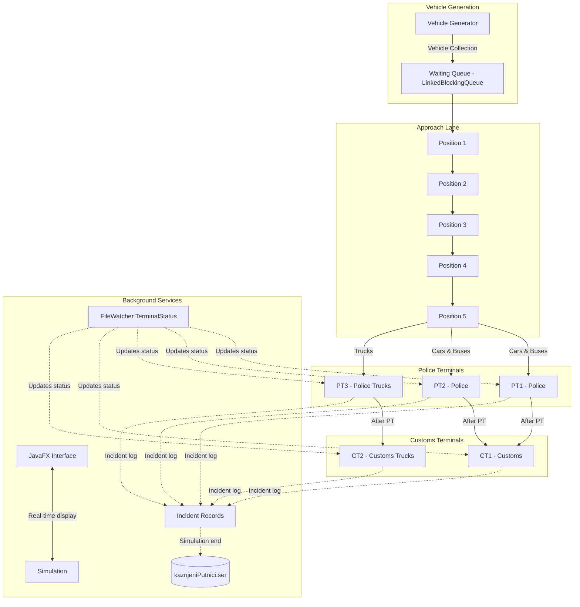

# 🚗 Border Crossing Simulator

A multithreaded border crossing simulation implemented in **Java** with a **JavaFX** graphical user interface. The project was developed as part of the **Programming Languages 2 (PJ2)** course at the Faculty of Electrical Engineering, University of Banja Luka.

---

## 📌 Project Overview

The system simulates the movement and inspection of various vehicle categories (passenger cars, trucks, buses) crossing an international border. The border crossing consists of:
- **3 Police Terminals** (PT1 and PT2 for passenger cars and buses, PT3 for trucks)
- **2 Customs Terminals** (CT1 for passenger cars and buses, CT2 for trucks)

Every vehicle, terminal, and background service for dynamic terminal state monitoring (`FileWatcher`) runs in **separate threads (multithreading)**, utilizing precise synchronization mechanisms (`wait/notify`, locks, daemon threads, and atomic variables).

---

## 🏗️ System Architecture



---

## ⚙️ Key Features

### 1. Vehicle and Passenger Model
- **Passenger Cars (`LicnoVozilo`)**:
  - Capacity: Up to 5 passengers.
  - No detailed luggage inspection at customs; processed after a fixed configured delay.
- **Buses (`Autobus`)**:
  - Capacity: Up to 52 passengers.
  - Detailed customs inspection of every passenger's suitcase/luggage.
- **Trucks (`Kamion`)**:
  - Capacity: Up to 3 passengers (driver and co-passengers).
  - Defined **declared** and **actual cargo weight**, alongside a status flag indicating whether customs documentation is required.
- **Passengers (`Putnik`)**:
  - Each passenger possesses an identification document (`Dokument`).
  - May carry a suitcase (`Kofer`) with personal luggage.

### 2. Probabilistic Events and Incident Handling
Generation parameters are fully customizable via the configuration file:
- **Invalid Identification Documents (3%)**:
  - If the **driver** lacks a valid document, the **entire vehicle is turned back/halted** and denied entry across the border.
  - If a **passenger** has an invalid document, the **passenger is removed from the vehicle**, added to the penalized individuals list, and the vehicle is permitted to proceed.
- **Prohibited Items in Luggage (10%)**:
  - During the customs check of a bus, any passenger found with prohibited items in their luggage is removed from the bus and logged.
- **Cargo Weight Overload for Trucks (20%)**:
  - In a configured percentage of cases, actual cargo weight exceeds declared weight by up to 30%. If overloaded, the truck is **denied border crossing**.
  - **Customs Documentation (50%)**: Probability of generating required customs documentation for truck cargo.

### 3. Dynamic Terminal Management (`FileWatcher`)
- The system employs Java NIO's **`WatchService`** to monitor real-time file updates in `radTerminala.txt`.
- During active simulation, modifying terminal states (`RADI` for active or `NE RADI` for inactive) dynamically opens or closes terminals without restarting the application:
  ```properties
  PT1=RADI
  PT2=NE RADI
  PT3=RADI
  CT1=RADI
  CT2=NE RADI
  ```
- When a terminal is closed, the GUI immediately displays a blocked indicator, and incoming vehicles are rerouted to active terminals.

### 4. Persistence and Logging
- **Serialization**: Upon simulation completion, the list of all passengers penalized or denied entry is serialized to a binary file `kaznjeniPutnici.ser` via `ObjectOutputStream`.
- **Exception Logging**: Integrated `java.util.logging.Logger` with XML formatting records runtime exceptions into `logger.log`.

---

## 🖥️ Graphical User Interface (JavaFX)

The application provides an interactive and visual simulation dashboard using multiple FXML views:
1. **Welcome Screen (`SceneDobrodosli.fxml`)**: Initial screen to launch the simulation.
2. **Main Simulation Window (`SceneSimulacijaPrelaza.fxml`)**:
   - Queue visualization (positions 1 through 5) with distinct vehicle icons.
   - Real-time display of active police and customs terminals and currently processed vehicles.
   - Visual indicators showing terminal operational status (open vs. blocked).
   - Running simulation stopwatch.
   - Pause and resume controls.
   - Progress bar and counter of processed vehicles.
3. **Vehicle Details (`InformacijeOIzabranomVozilu.fxml`)**:
   - Clicking any vehicle in the lane opens an inspection dialog showing vehicle specs, driver info, passenger list, luggage items, and cargo mass.
4. **Vehicles in Queue (`SceneVozilaURedu.fxml`)**:
   - Dedicated dialog listing all vehicles waiting in the buffer queue.
5. **Incident Overview (`SceneIncidenti.fxml`)**:
   - Real-time tabular log of all recorded border incidents.

---

## 📁 Project Structure

```plaintext
border-crossing-simulator/
├── .gitignore                          # Ignored files configuration
├── README.md                           # Project documentation
│
├── PROJEKTNI_ZADATAK/                  # Core simulation logic module
│   ├── simulacioniParametri.txt        # Primary configuration file
│   ├── RadTerminala/
│   │   └── radTerminala.txt            # Dynamic terminal status file
│   ├── logs/                           # Log output directory (logger.log)
│   ├── serijalizacijaKaznjenihPutnika/ # Serialization output directory (kaznjeniPutnici.ser)
│   └── src/
│       ├── module-info.java
│       └── org/unibl/etf/
│           ├── putnik/                 # Putnik, Kofer, Dokument classes
│           ├── putnikgenerator/        # Passenger, document, and suitcase generator
│           ├── vozila/                 # Vozilo, LicnoVozilo, Kamion, Autobus classes
│           ├── vozilagenerator/        # Vehicle generator
│           ├── terminali/              # Terminal, PolicijskiTerminal, CarinskiTerminal
│           ├── simulacija/             # Simulacija, FileWatcher, MyLogger
│           └── util/                   # SimulacioniParametri, Util
│
└── GUI/                                # JavaFX graphical user interface module
    └── src/
        ├── module-info.java
        └── application/
            ├── Main.java               # JavaFX application entry point
            ├── IzvrsavacSimulacije.java
            ├── SimulationSceneController.java
            ├── IncidentiController.java
            ├── InformacijeController.java
            ├── RedVozilaController.java
            ├── Stoperica.java
            ├── application.css         # UI stylesheet
            ├── *.fxml                  # FXML layout definitions
            └── *.png                   # Graphical assets (vehicle and terminal icons)
```

---

## ⚙️ Configuration Parameters (`simulacioniParametri.txt`)

Simulation parameters can be tuned in `PROJEKTNI_ZADATAK/simulacioniParametri.txt`:

| Parameter | Default Value | Description |
| :--- | :--- | :--- |
| `UKUPAN_BROJ_LICNIH_VOZILA` | `35` | Number of passenger cars in queue |
| `UKUPAN_BROJ_KAMIONA` | `10` | Number of trucks in queue |
| `UKUPAN_BROJ_AUTOBUSA` | `5` | Number of buses in queue |
| `BROJ_POLICIJSKIH_TERMINALA` | `3` | Total number of police terminals |
| `BROJ_CARINSKIH_TERMINALA` | `2` | Total number of customs terminals |
| `DUZINA_STAZE` | `7` | Visual lane matrix length |
| `VJEROVATNOCA_NEISPRAVNOG_DOKUMENTA` | `3` | Probability of invalid identity document (%) |
| `VJEROVATNOCA_NEDOZVOLJENIH_STVARI_U_KOFERU` | `10` | Probability of prohibited items in luggage (%) |
| `POSTOTAK_KAMIONA_SA_VECOM_MASOM_TERETA` | `20` | Percentage of overloaded trucks (%) |
| `POSTOTAK_UVECANJA_MASE_TERETA` | `30` | Maximum percentage of cargo weight overload (%) |

---

## 🚀 Getting Started

### Prerequisites
- **Java Development Kit (JDK)**: Version 17 or higher.
- **JavaFX SDK**: Version 17 or higher (if not bundled with your JDK distribution).
- **IDE**: Eclipse IDE (with e(fx)clipse / JavaFX support) or IntelliJ IDEA.

### Running via Eclipse IDE:
1. Open Eclipse and import both projects (`PROJEKTNI_ZADATAK` and `GUI`) via **File -> Import -> Existing Projects into Workspace**.
2. Ensure that the `GUI` project references `PROJEKTNI_ZADATAK` in its Java Build Path (configured through `module-info.java`).
3. If your JDK does not include JavaFX modules, add VM arguments in your Run Configuration:
   ```bash
   --module-path /path/to/javafx-sdk/lib --add-modules javafx.controls,javafx.fxml,javafx.graphics
   ```
4. Run the main class: `GUI/src/application/Main.java`.
